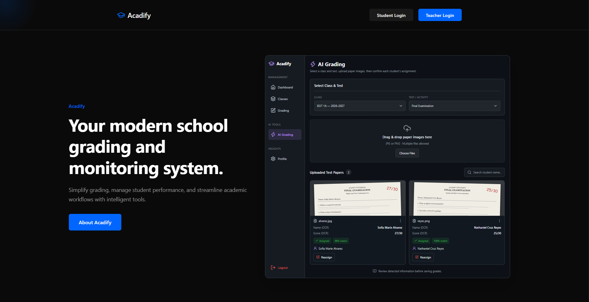
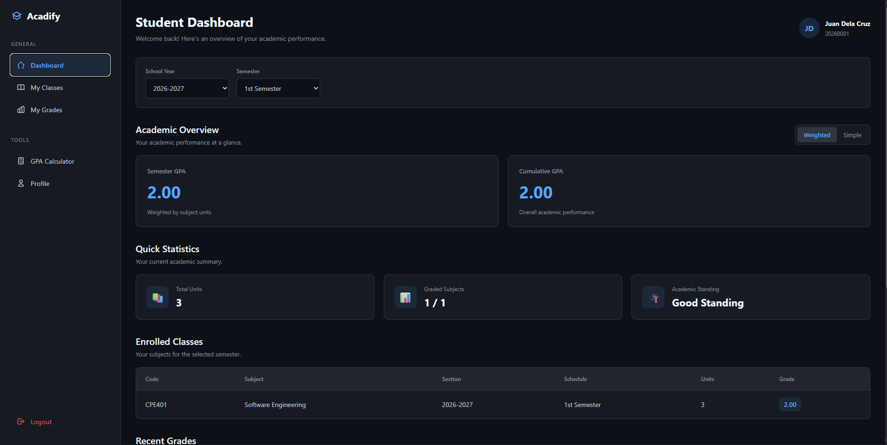
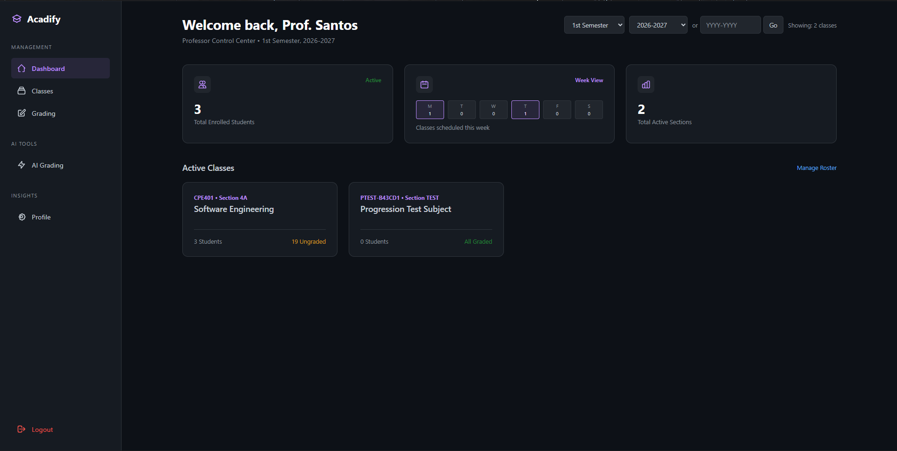
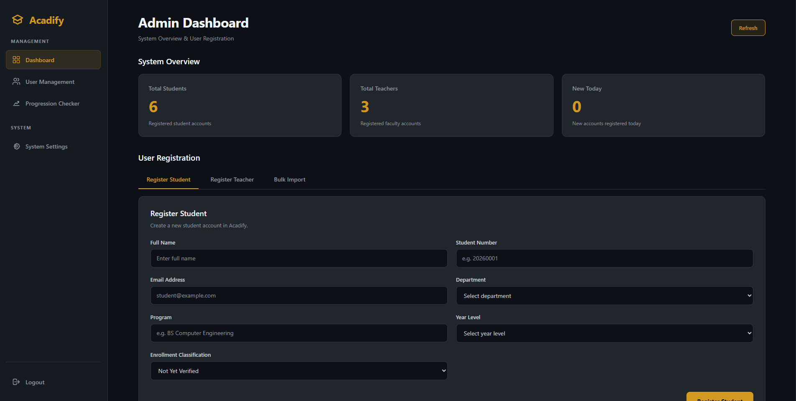

# Acadify — School Grading System

Acadify is a web-based school grading system designed to help manage academic records and grading workflows for students, teachers, and administrators.

This repository contains the **frontend application**, built with React, TypeScript, and Vite. It connects to a Flask backend through a REST API.

## Screenshots

<!--
Save actual screenshots in docs/screenshots/ and uncomment each image
after adding the corresponding file.
-->

<!-- Homepage -->


<!-- Student Dashboard -->


<!-- Teacher Dashboard -->


<!-- Admin Dashboard -->


*Screenshots will be added as the frontend interface is finalized.*

## Features

Acadify is being developed to support the following workflows:

- **Student portal** — access student-facing academic information.
- **Teacher portal** — support teacher-facing grading and academic workflows.
- **Administrator portal** — support administrative management of the grading system.
- **API integration** — communicate with the Flask backend.
- **Responsive interface** — provide an interface that adapts to different screen sizes.

Feature availability depends on the current implementation and backend integration.

## Technology Stack

| Technology | Purpose |
|---|---|
| React | Building the user interface |
| TypeScript | Type-safe JavaScript development |
| Vite | Frontend development server and build tool |
| CSS | Styling and responsive layouts |
| ESLint | Code quality and linting |
| Flask REST API | Backend integration |

## Project Structure

```text
Acadify-frontend/
├── public/                 # Static assets
├── src/                    # Application source code
│   ├── components/         # Reusable UI components
│   ├── context/            # Shared application state
│   ├── pages/              # Application pages
│   └── ...                 # Other source files
├── index.html
├── package.json
├── package-lock.json
├── tsconfig.json
├── vite.config.ts
└── README.md
```

*The exact contents of `src/` may vary as development continues.*

## Getting Started

### Prerequisites

Make sure you have installed:

- [Node.js](https://nodejs.org/) — preferably an LTS version.
- npm, which is included with Node.js.
- Git, if you want to clone the repository.

### 1. Clone the repository

```bash
git clone https://github.com/uuell/Acadify-frontend.git
cd Acadify-frontend
```

### 2. Install dependencies

```bash
npm install
```

### 3. Configure environment variables

Create a local `.env` file in the project root if the application requires environment variables.

For example, if the frontend uses a Vite API base URL:

```env
VITE_API_BASE_URL=http://127.0.0.1:5000
```

Use the variable name and backend URL expected by the actual application. The example above is illustrative; verify it against the project's source code.

**Security:** Never commit `.env` files, API keys, passwords, or other secrets to GitHub.

### 4. Start the development server

```bash
npm run dev
```

Open the local URL printed in the terminal, commonly `http://localhost:5173`.

### 5. Build for production

```bash
npm run build
```

To preview the production build locally:

```bash
npm run preview
```

## Backend Integration

Acadify uses a separate Flask backend to handle server-side logic, authentication, and academic data.

Make sure the backend is running and the frontend's API configuration points to the correct backend URL. Authentication and API requests must use the configuration expected by the backend.

The frontend and backend are maintained in separate repositories.

## Development Status

Acadify is an ongoing portfolio project. The frontend is being developed incrementally, with existing interfaces being migrated to React and integrated with the Flask API.

Some features, integrations, and deployment configurations may still be in progress.

## Related Repository

- **Frontend:** [Acadify-frontend](https://github.com/uuell/Acadify-frontend)
- **Backend:** [Acadify-Main](https://github.com/uuell/Acadify-Main)

## License

No license has been specified yet. All rights are reserved by the project author unless a license is added to this repository.
